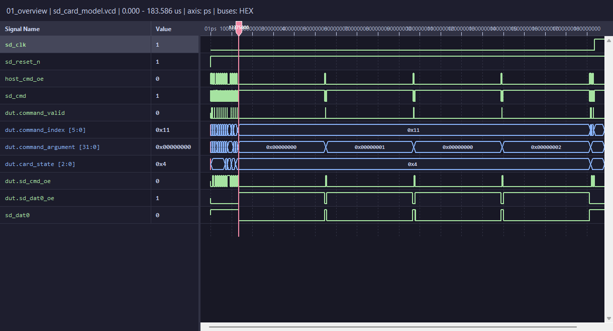
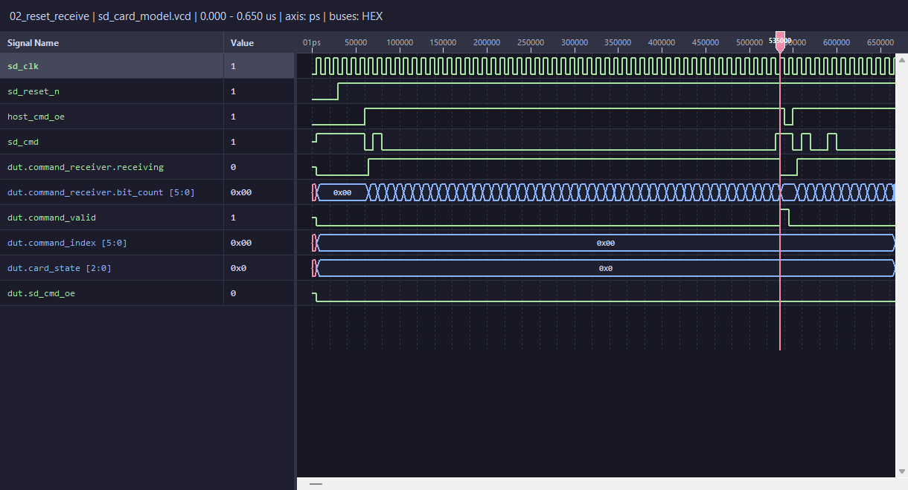
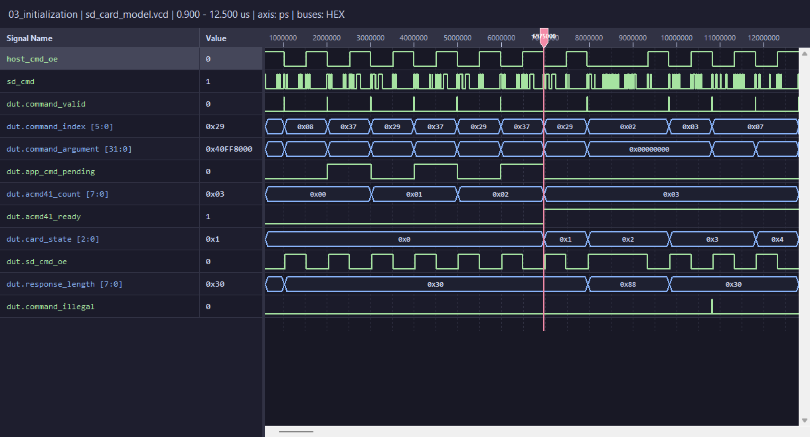
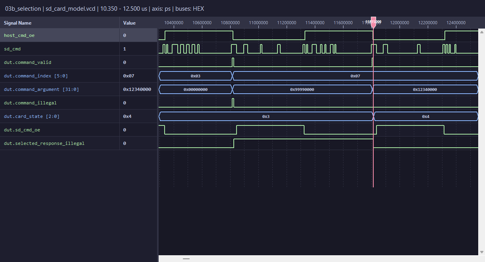
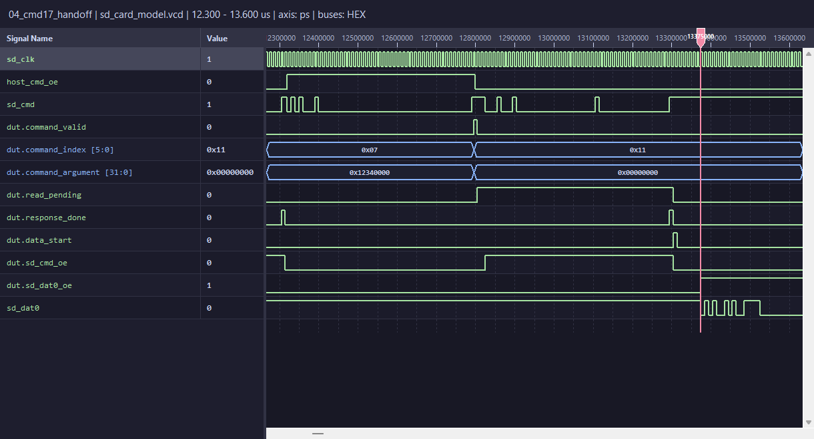
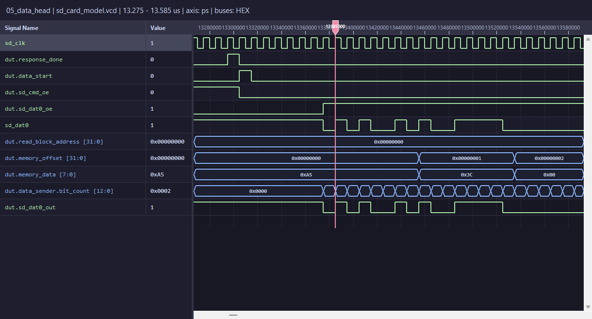
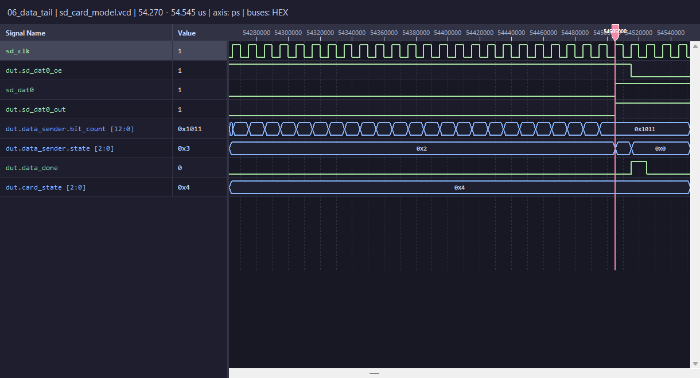
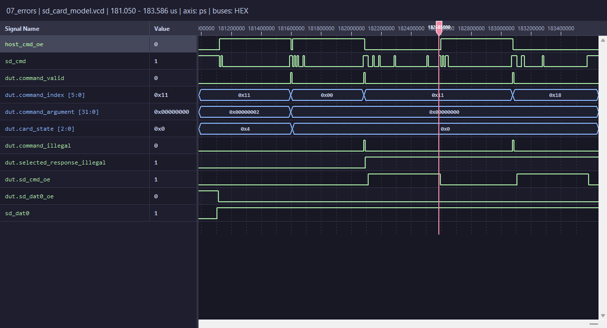

# SDカードモデル波形 walkthrough2

## 1. この資料の対象と読み方

既存の`sd_card_model.vcd`に記録された、リセット、初期化、4回のブロック読み出し、最後の異常系を順に説明する。[walkthrough1](waveform_walkthrough.md)を補う、画像付きのRTL追跡ガイドである。

- 対象は[テストベンチ](../tb/tb_sd_card_model.sv)のシミュレーション。実カードの測定波形ではない。
- VCDは1,152,320 bytes、時刻単位は1 ps、最終記録時刻は183.586 us。`sd_clk`は10 ns周期（100 MHz）。
- 画像は改修済み`waveform_viewer`の`WaveformCanvas`で対象VCDを読み込み、必要な信号と時刻範囲を選んだGUIを撮影したもの。模式図ではない。ビューア本体やRTLは変更していない。
- 図の信号名は見やすくするため最上位の`tb_sd_card_model.`を省略した。`dut.`はカードモデル内部、それ以外はテストベンチ側。ビューアのパーサーでは最上位の信号が`host_cmd_oe`などの短い名前で表示される。
- 画像上部の範囲はus、時間軸の数値はps。例えば`13375000` psは13.375 us。バス値は16進で、`0x11`はCMD17、`0x18`はCMD24、`0x29`はACMD41、`0x37`はCMD55。
- 赤い縦線は確認用カーソル。左側のValueはその時刻の値であり、表示区間全体の値ではない。
- 広い範囲の表示では細かいエッジが間引かれる。全体図でクロックが平坦に見えても停止とは判断しない。ビットや短いパルスは拡大図とVCDの実測値で確認する。

対象VCDのSHA-256:

```text
afca73aa05a35f86a719cb67914c2098891d2ee4797e9c720a23f3cad2366e9d
```

再生成するとVCDヘッダーの日付が変わり、同じシミュレーション挙動でもハッシュは変わる。

### 最初に押さえる信号

| 信号 | 見ること |
| --- | --- |
| `sd_reset_n`, `sd_clk` | Lowでリセット。Hostはクロックの立ち下がりでCMDを出し、カードは立ち上がりで受信する。 |
| `host_cmd_oe` | HostがCMDラインを駆動する期間。DUTの内部信号ではない。 |
| `dut.command_valid` | 48ビットのコマンドを受信し終えたとき、1クロックだけHighになる。 |
| `dut.command_index`, `dut.command_argument` | 受信済みの番号と引数。次のコマンド受信完了まで保持される。 |
| `dut.card_state` | 0=IDLE、1=READY、2=IDENT、3=STANDBY、4=TRANSFER。 |
| `dut.sd_cmd_oe` | カードがCMD応答を駆動する期間。 |
| `dut.sd_dat0_oe` | カードがDAT0データを駆動する期間。 |

`sd_cmd`と`sd_dat0`はテストベンチでプルアップされたライン。Highだけでは「1を駆動中」と「High-Zに解放中」を区別できないため、必ず`*_oe`を一緒に見る。

## 2. 全体を俯瞰する



左端の約12 usまでに初期化とカード選択を終える。その後、`sd_dat0_oe`が長くHighになる区間が4回あり、各区間が1回のCMD17による512バイト転送に対応する。最後はCMD0でIDLEへ戻り、エラー応答を2回返して終了する。

`command_index`が長い間`0x11`のままでも、1つのコマンドが続いているわけではない。同じCMD17を繰り返しているため番号の値は変わらず、`command_valid`の各パルスで新しい受信と判断する。引数は`0 → 1 → 0 → 2`となる。

| 読み出し | CMD17受信完了 (us) | 引数=ブロック番号 | 先頭バイトアドレス | DAT0駆動区間 (us) | 内容 |
| --- | ---: | ---: | ---: | --- | --- |
| 1 | 12.795 | 0 | 0 | 13.375–54.515 | `A5 3C`、以降510バイトは0 |
| 2 | 54.995 | 1 | 512 | 55.575–96.715 | 未記載領域。512バイトすべて0 |
| 3 | 97.195 | 0 | 0 | 97.775–138.915 | 1回目と同じデータ |
| 4 | 139.395 | 2 | 1024 | 139.975–181.115 | イメージ範囲外。512バイトすべて0 |

このテストではイメージ容量が1024バイト。範囲外ブロックもエラーではなくゼロデータとして返すモデル仕様である。4回とも`card_state=4`を維持する。

## 3. リセットから最初のコマンド受信まで



1. 開始直後の一部内部信号はXだが、最初の立ち上がり（0.005 us）でリセット値になる。
2. 0.030 usで`sd_reset_n=1`となる。カードはIDLEのまま。
3. 0.060 usで`host_cmd_oe=1`となり、HostがCMD0を送信する。最初のStart Bit=0を受信すると`command_receiver.receiving`が立つ。
4. 受信回路は48ビットを蓄積する。最後のビットを受けた0.535 usで`command_valid=1`、`command_index=0`、`command_argument=0`が確定する。
5. 次の立ち上がりで状態管理回路がコマンドを処理する。CMD0には応答がないので、カードの`sd_cmd_oe`は立たない。

図の右端では次のCMD8の送信が始まっている。CMD0の受信途中ではない。

追うRTL: [sd_command_receiver.sv](../rtl/sd_command_receiver.sv)。`receiving`、`bit_count`、`command_shift`、最後の`command_valid`の順で追うと、シリアル入力からコマンド値への変換が分かる。

## 4. 初期化とカード選択



| コマンド | 受信完了 (us) | 主な引数・応答 | 状態の結果 |
| --- | ---: | --- | --- |
| CMD8 | 1.025 | 引数`0x000001AA`。R7も`0x000001AA`を返す。 | IDLE |
| CMD55 → ACMD41、1回目 | 2.015 → 3.005 | CMD55で`app_cmd_pending`が立つ。ACMD41のR3 OCR=`0x40FF8000`。 | IDLE、count=1 |
| CMD55 → ACMD41、2回目 | 3.995 → 4.985 | R3 OCR=`0x40FF8000`。まだReadyではない。 | IDLE、count=2 |
| CMD55 → ACMD41、3回目 | 5.975 → 6.965 | R3 OCR=`0xC0FF8000`。bit 31のReadyが1になる。 | 6.975 usでREADY、count=3 |
| CMD2 | 7.955 | R2で固定CIDを返す。MID=`01`、製品名=`RTISD`、Serial=`12345678`。 | 7.965 usでIDENT |
| CMD3 | 9.825 | R6でRCA=`0x1234`を返す。 | 9.835 usでSTANDBY |

CMD2だけ`response_length=0x88`（136ビット）なので、`sd_cmd_oe`の山が他より長い。他の応答は`0x30`（48ビット）。`acmd41_ready`や状態は受信完了の次の立ち上がりで更新される。



- 10.815 us: CMD7の引数は`0x99990000`。上位16ビットのRCAが不一致なので`command_illegal`が立ち、STANDBY（3）を維持する。R1のstatusは`0x00400600`で、bit 22（ILLEGAL_COMMAND）が1。
- 11.805 us: CMD7の引数は`0x12340000`。RCAが一致し、11.815 usでTRANSFER（4）へ移る。エラーのないR1を返す。
- このモデルはコマンド受理時の状態でR1を組み立てるため、成功したCMD7のR1 statusは`0x00000600`（遷移前のSTANDBY）。送信中の`card_state=4`と同じ値がR1に入るとは限らない。

追うRTL: [sd_command_decoder.sv](../rtl/sd_command_decoder.sv)でCMD55後のACMD判定、[sd_state_manager.sv](../rtl/sd_state_manager.sv)で回数・状態・RCA判定、[sd_card_model.sv](../rtl/sd_card_model.sv)で応答内容の組み立てを見る。

## 5. CMD17受信からR1、DAT0への引き継ぎ



| 時刻 (us) | 観測すること |
| --- | --- |
| 12.795 | `command_valid=1`。CMD17=`0x11`、引数=0が確定する。 |
| 12.805 | ブロック番号を`read_block_address`へ保持し、`read_pending=1`になる。 |
| 12.825 | `sd_cmd_oe=1`。R1のStart Bitを送信し始める。 |
| 13.295 | R1の最後のEnd Bitを送信。`response_done=1`になる。 |
| 13.305 | CMDラインを解放し、`sd_cmd_oe=0`。`data_start`が1クロック立ち、`read_pending=0`になる。 |
| 13.375 | `sd_dat0_oe=1`、`sd_dat0=0`。DAT0のStart Bitを送信する。 |

`command_argument`は全コマンド共通の引数だが、CMD17ではSDHC相当のブロック番号として扱う。

```text
先頭バイトアドレス = read_block_address × 512
読み出すバイト位置 = 先頭バイトアドレス + memory_offset
```

R1最終ビット（13.295 us）からDAT0開始（13.375 us）までは80 ns、つまり8クロック。**`sd_cmd_oe`が下がる時刻（13.305 us）を起点にすると70 ns、7クロック**なので、待ち時間を数える基準を取り違えない。

追うRTL: [sd_response_generator.sv](../rtl/sd_response_generator.sv)の`response_done`、[sd_card_model.sv](../rtl/sd_card_model.sv)の`read_pending`と`data_start`、[sd_data_sender.sv](../rtl/sd_data_sender.sv)の待機から送信への遷移。

## 6. DAT0先頭のA5、3Cをビット単位で読む



| 区間 | DAT0の意味 |
| --- | --- |
| 13.375–13.385 us | Start Bitの`0`、1クロック |
| 13.385–13.465 us | 1バイト目`A5`=`1010 0101`、MSB firstで8クロック |
| 13.465–13.545 us | 2バイト目`3C`=`0011 1100`、MSB firstで8クロック |
| 13.545 us以降 | 3バイト目以降の0が続く |

```text
             Start     A5           3C
DAT0:          0     1 0 1 0 0 1 0 1   0 0 1 1 1 1 0 0 ...
```

「A」と「5」を別々に送るのではなく、1バイト`A5`の8ビットを送っている。連続した0や1は波形のエッジが出ないため、`sd_clk`の各周期で区切って読む。

`memory_offset`と`memory_data`は次に使用するバイトの組合せ回路出力。`bit_count`が送信の立ち上がりで進むため、最後のビットをDAT0へ出した直後に次バイトの値へ変わる。例えば`memory_data`は13.455 usで`3C`になるが、DAT0上で`3C`の最初のビットが出るのは13.465 us。内部メモリ値と、既に出力へ保持されたビットを区別する。

追うRTL: [sd_memory_reader.sv](../rtl/sd_memory_reader.sv)のアドレス換算と`data_out`、[sd_data_sender.sv](../rtl/sd_data_sender.sv)の`memory_data[7 - ...]`によるMSB firstの選択。

## 7. 512バイトの後、CRCとEnd Bitで解放する



1回のDAT0駆動時間は、4回とも41.140 us（4114クロック）。

```text
Start Bit 1 + データ 512×8 + Dummy CRC 16 + End Bit 1 = 4114ビット
```

1回目の末尾では以下を確認する。

| 時刻・区間 (us) | 内容 |
| --- | --- |
| 54.335 | 最後のデータビットを出力する。 |
| 54.345–54.505 | Dummy CRCの16ビット。すべて0。 |
| 54.505–54.515 | End Bitの1。`sd_dat0_oe`はまだ1で、カードが駆動中。 |
| 54.515 | `sd_dat0_oe=0`となり、DAT0をHigh-Zへ解放する。`data_done`が1クロック立つ。 |

末尾データもCRCも0なので、CRC開始時にDAT0のエッジはない。区切りは時刻・クロック数・内部カウンターから判断する。End Bitの後もラインがHighなのはプルアップのためで、解放は`sd_dat0_oe`の下降で確認する。

`data_sender.state`は2（SEND）→3（RELEASE）→0（IDLE）へ移る。一方、`card_state`は4（TRANSFER）のまま。「データ送信FSMがIDLEに戻る」と「カードがIDLEに戻る」は別の動作。

ここでのCRCは計算されたSD CRC16ではなく、仕様上のゼロ固定Dummy CRCである。

## 8. 4回の読み出し後のCMD0とエラー応答



| 時刻 (us) | 動作 |
| --- | --- |
| 181.115 | 4回目のDAT0転送を終了し、`sd_dat0_oe=0`。 |
| 181.595 | CMD0受信完了。 |
| 181.605 | `card_state`が4→0（IDLE）へ戻る。CMD0には応答しない。 |
| 182.085 | IDLEでCMD17を受信する。不正状態のため`command_illegal`が立つ。 |
| 182.115–182.595 | 48ビットのR1エラー応答。status=`0x00400001`。DAT0は送信しない。 |
| 183.075 | 非対応のCMD24（表示値`0x18`、書き込み）を受信する。 |
| 183.105–183.585 | 48ビットのR1エラー応答。status=`0x00400000`。DAT0は送信しない。 |

両エラー応答ともstatus bit 22のILLEGAL_COMMANDが1。モデル内の異なる応答組み立て経路により下位ビットは異なるが、どちらも「エラー応答のみ、データなし」という意図に一致する。

`command_illegal`は`command_valid`中の短い判定信号。応答期間までHighを保つ必要はない。その判定を`selected_response_illegal`へ保持しているため、応答中はこちらを見る。

末尾の2つの`sd_cmd_oe`の山は5回目・6回目の読み出しではない。`sd_dat0_oe`が再度立たず、`card_state=0`のままなので、正常データ転送を始めていないことが確認できる。

## 9. 確認結果と再現方法

画像は流れや信号の関係を説明するためのもの。妥当性は画像だけでなく、対象VCDから次の値を抽出して確認した。

- 19コマンドの受信と17回の応答。2回のCMD0には応答なし。
- CMD8のecho、ACMD41のOCR（3回目でReady）、CMD2の136ビット応答、CMD3のRCA。
- HostとカードのCMD駆動開始時刻、およびRCA不一致・不正状態・非対応コマンドのR1エラービット。
- 4回すべてのDAT0について、先頭から512バイト全体、MSB first、Start Bit、CRCの0×16ビット、End Bitを確認。
- 4回すべての転送長4114クロック、およびR1最終ビットからDAT0開始まで8クロックを確認。
- 初期化の状態遷移と、最後のCMD0後に追加DAT0転送がないことを確認。

**このVCDに記録されたテストシナリオはモデルの期待動作と一致する。** 全SD規格準拠、実CRCの正しさ、別のパラメーターや未実行のコマンドまで確認したという意味ではない。

VCD再生成コマンドは[walkthrough1の波形ダンプ再現手順](waveform_walkthrough.md#波形ダンプの再現手順)を参照。今回の資料作成では対象VCDを上書きせず、既存の記録を使用した。

改修済みビューアをこのワークスペースのルートから起動する場合:

```powershell
Set-Location .\rtl_lite_sim
.\.venv\Scripts\python.exe -m waveform_viewer ..\generate_rtl\sd-card-model\sd_card_model.vcd
```

`Ctrl+F`で全体表示し、必要な信号を残して図の範囲をドラッグ拡大する。信号名右クリックで基数や順序を変更できる。画像上部の時刻範囲を目印に、全体→受信→状態→CMD応答→DAT0の順で追うとよい。ビューアやPython環境はこのモデルリポジトリには含まれないため、別環境では起動パスを合わせる。
