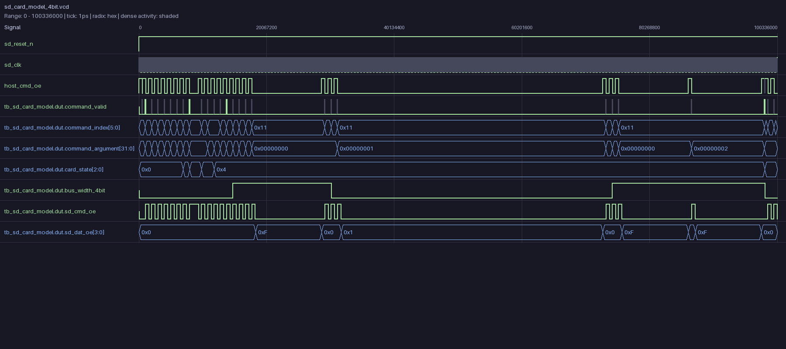
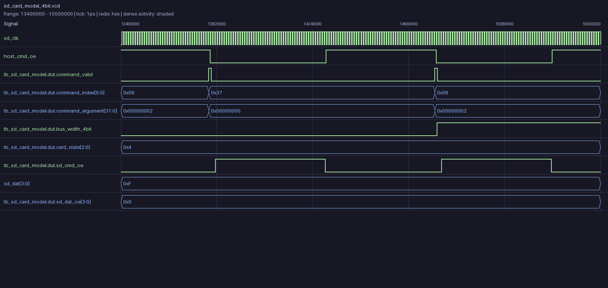
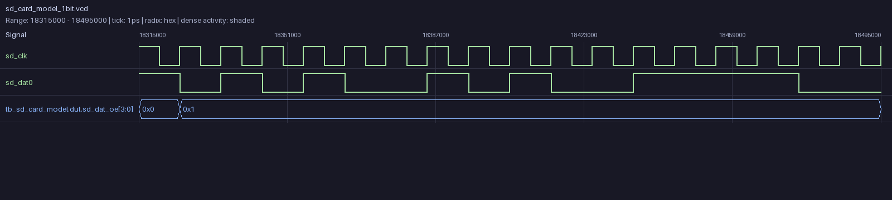

# SD Native 1-bit / 4-bit 波形 walkthrough

この資料は、同一のSDカードモデルを1-bitビルドと4-bitビルドで実行したVCDから、初期化、ACMD6による幅切替、CMD17のデータ線を追う。波形はIcarus VCDをヘッドレスPNG出力したもので、GUIビューアは使用していない。

## 再現手順

`sd-card-model`ディレクトリからPowerShellで実行する。`tb/boot.mem`を相対パスで読むため、カレントディレクトリをこの場所に合わせる。

```powershell
# 1-bit I/F、VCDあり
iverilog -g2012 -D SD_CARD_MODEL_DUMP_WAVEFORM -s tb_sd_card_model -o tb_sd_card_model_1bit.vvp rtl\*.sv tb\tb_sd_card_model.sv
vvp tb_sd_card_model_1bit.vvp

# 4-bit I/F、VCDあり
iverilog -g2012 -D SD_CARD_MODEL_4BIT -D SD_CARD_MODEL_DUMP_WAVEFORM -s tb_sd_card_model -o tb_sd_card_model_4bit.vvp rtl\*.sv tb\tb_sd_card_model.sv
vvp tb_sd_card_model_4bit.vvp
```

出力は`sd_card_model_1bit.vcd`と`sd_card_model_4bit.vcd`。VCDを出さずにテストだけ行う場合は`SD_CARD_MODEL_DUMP_WAVEFORM`を外す。`SD_CARD_MODEL_4BIT`を付けるとトップI/Fが`sd_dat0`から`sd_dat[3:0]`へ変わり、ACMD6の4-bit要求が有効になる。どちらのビルドもリセット直後は1-bitで、4-bitビルドでは初期化とCMD7までを1-bitで行う。

## 全体の動作



4-bitビルドのテストでは、TRANSFER状態でCMD55なしのCMD6を先に送り、`ILLEGAL_COMMAND`で拒否されることを確認する。その後、正しいCMD55 + ACMD6を使って幅を切り替える。カード状態はCMD17の間もTRANSFER (`4`) を維持する。

| 動作 | 幅フラグ変化 / CMD17のブロック引数 | DAT駆動区間 (us) | DAT駆動時間 |
| --- | --- | --- | ---: |
| 4-bit読み出し | 14.785 usで4-bit、block 0 | 18.325–28.745 | 10.420 us / 1042 clocks |
| 1-bit読み出し | 30.225 usで1-bit、block 1 | 31.785–72.925 | 41.140 us / 4114 clocks |
| 4-bit読み出し | 74.405 usで4-bit、block 0 | 75.965–86.385 | 10.420 us / 1042 clocks |
| 4-bit読み出し | block 2 | 87.445–97.865 | 10.420 us / 1042 clocks |

4回目の転送後にCMD0が幅を1-bitへ戻す（98.355 us）。末尾の不正状態CMD17と非対応CMD24にはR1エラーだけを返し、DAT転送を始めない。

## ACMD6で幅を切り替える



- 12.795 usのCMD6はCMD55が先行しないためACMD6として解釈されず、R1エラー。幅フラグは0のまま。
- 13.785 usのCMD55に続く14.775 usのCMD6はArgument[1:0]=`10`。14.785 usに`bus_width_4bit`が1になる。
- ACMD6の引数`01`は不正値として拒否し、4-bit幅を保つ。
- 後続のCMD55 + ACMD6でArgument[1:0]=`00`を指定すると1-bitへ戻る。その後、再度`10`を指定して4-bitへ戻す。
- `sd_dat[3:0]`がHighに見えている期間も、`sd_dat_oe=0`ならカードはラインをHigh-Zへ解放中。プルアップ値と駆動値を区別する。

## CMD17先頭データ

1回目のCMD17は引数block 0で、R1応答後8クロック待って18.325 usからDAT送信を始める。両図は同じ先頭2バイトを異なるバス幅で示す。



1-bitではStart Bit `0`の後、`A5 = 1010_0101`、`3C = 0011_1100`を各バイトMSB firstで送る。1バイトに8クロックかかる。

![4-bit: DAT[3:0]のStart Bit、上位/下位ニブル](waveform_4bit_data_head.png)

4-bitではStart Bit `0000`の後、1クロック目に`DAT[3:0]=A`（byte[7:4]）、次のクロックに`5`（byte[3:0]）を出す。次のバイトは`3`、`C`となる。図中の`sd_dat_oe=F`は4本すべてを駆動中、`0`は全線解放中を表す。

各モードでテストベンチは512バイトすべてを再構成して`boot.mem`と比較する。Dummy CRCは実CRCではなく、1-bitではDAT0を16クロック、4-bitでは4本すべてを16クロック0にする。Start、データ、CRC、Endを含む転送長は1-bitで4114クロック、4-bitで1042クロック。

## 確認結果と制約

- defineなしの1-bitビルド: ACMD6の1-bit選択、4-bit要求の拒否、4回のCMD17、範囲外ゼロ埋め、エラー応答が全てPASS。
- `SD_CARD_MODEL_4BIT`ビルド: 1→4→1→4-bitの切替、未対応CMD6の拒否、各幅での全512バイト比較、全DAT線のStart/CRC/End、転送長、CMD0による1-bit復帰が全てPASS。
- 表示波形と時刻はこのテストベンチと固定パラメーターでのシミュレーション結果。CRC計算、実カードのタイミング適合、UHS等を保証するものではない。
